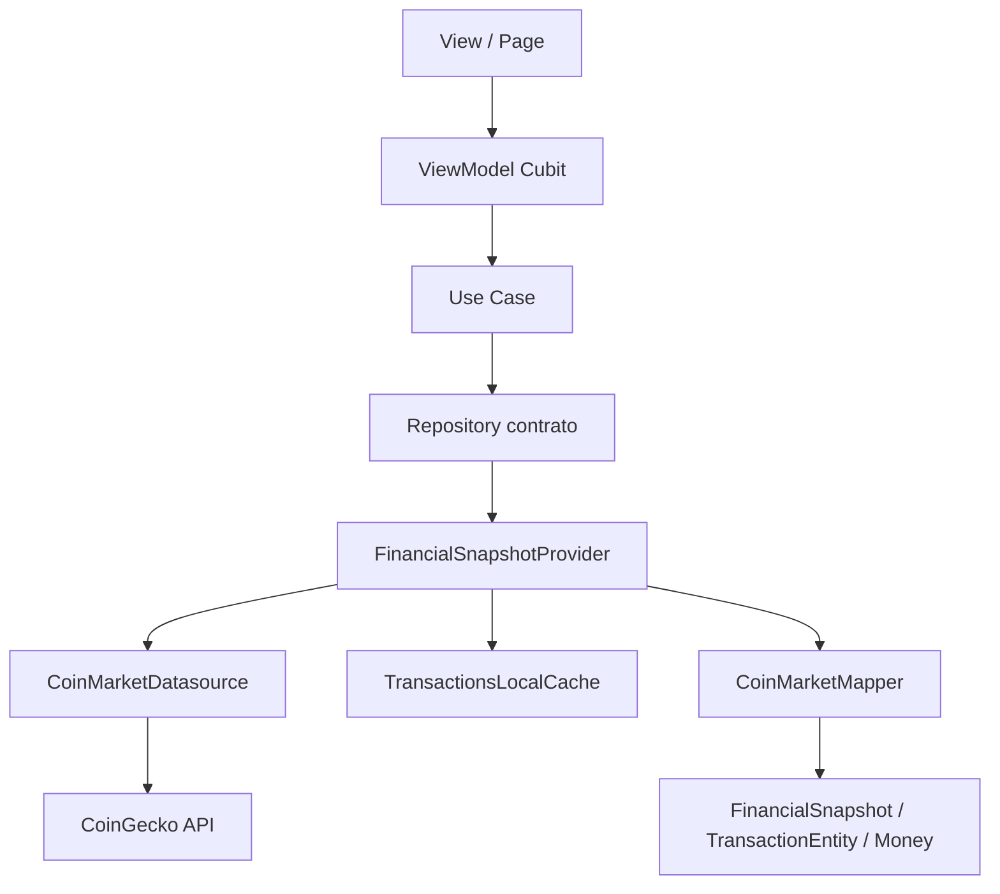

# ADR 0001 — Camadas MVVM e fluxo de dados

## Contexto

O enunciado pede MVVM com separação entre apresentação, domínio e dados, DI e inversão de dependência.

## Decisão

Organização em três camadas principais, com features por vertical (`dashboard`, `transactions`, `transaction_detail`) e um `core` compartilhado.

| Camada | Responsabilidade | Exemplos |
|--------|------------------|----------|
| **Presentation** (View + ViewModel) | UI e orquestração de estado | `*_page.dart`, `*_cubit.dart` |
| **Domain** | Regras, entidades, use cases, contratos | `Money`, use cases, repositories abstratos |
| **Data / Infra** | HTTP, cache, DTOs, mappers, implementações | `CoinGeckoService`, `CoinMarketMapper`, `*RepositoryImpl` |

DI com **GetIt** (`lib/app/core/di/injection.dart`): abstrações no domínio, implementações registradas na borda.

### Fluxo de dados

`FinancialSnapshotProvider` é a **fonte única de verdade** do snapshot (saldo + lista de transações). Dashboard, extrato e detalhe leem o mesmo snapshot, evitando inconsistência entre telas.

## Alternativas consideradas

- **Clean Architecture estrita com muitas pastas por feature**: descartada por overhead em um app de escopo limitado.
- **Dados só em mocks/json-server**: descartada; a API real exercita 429, cache e conectividade.

## Consequências

- Testabilidade alta (mocks nos contratos).
- Mapeamento CoinGecko concentrado no mapper/infra, domínio livre de detalhes HTTP.
