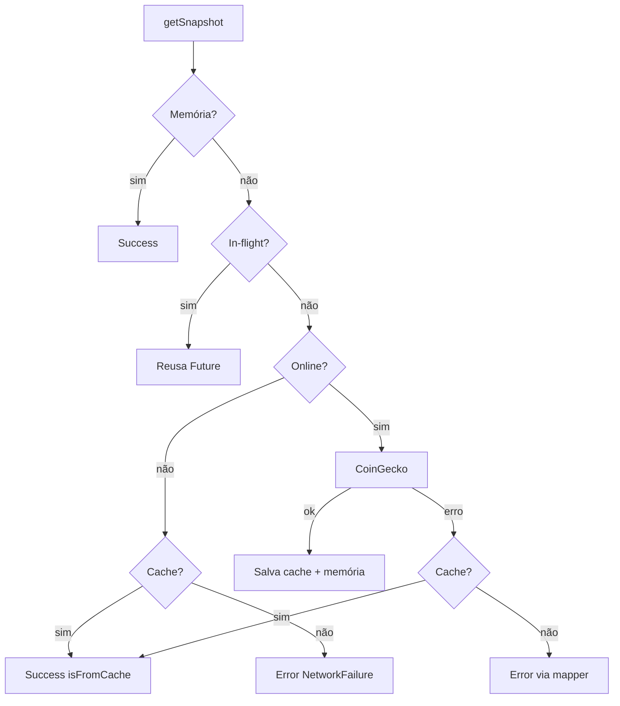

# ADR 0003 — Cache, offline, 429 e erros (`Result`)

## Contexto

Requisitos: cache local com sinalização de dados desatualizados, ausência de conexão, deduplicação/cancelamento, HTTP 429 com backoff, e erros tipados sem exceções cruas na UI.

## Decisões

### Cache e offline

- Persistência do último market chart + preço em **SharedPreferences** (`TransactionsLocalCache`).
- Em falha de rede ou offline (`NetworkInfo` via `connectivity_plus`), o provider devolve snapshot com `isFromCache: true`.
- UI mostra `StaleCacheBanner` / `OfflineBanner` conforme flags no estado do Cubit.

### Fonte única + dedupe / CancelToken

`FinancialSnapshotProvider`:

- Mantém snapshot em memória.
- Deduplica chamadas in-flight (mesma `Future` compartilhada).
- Usa `CancelToken` do Dio; `forceRefresh` / `clearMemory` cancela a requisição obsoleta.

### HTTP 429 e retentativas

`RetryInterceptor` no Dio:

- Retenta status `429`, `500`, `502`, `503`, `504`.
- Backoff exponencial com jitter; respeita header `Retry-After` quando presente (capado por delay máximo).

### Erros tipados

- Hierarquia `Failure` (`NetworkFailure`, etc.).
- `Result<T>` selado (`Success` / `Error`) retornado por use cases e repositórios.
- `DioExceptionMapper` traduz exceções Dio → `Failure` antes da presentation.

## Fluxo resumido

## Consequências

- App utilizável sem rede após a primeira carga bem-sucedida.
- Menos pressão no free tier da CoinGecko (dedupe + cache).
- Limite: “online” via connectivity ≠ garantia de internet real (ver ADR 0004).
